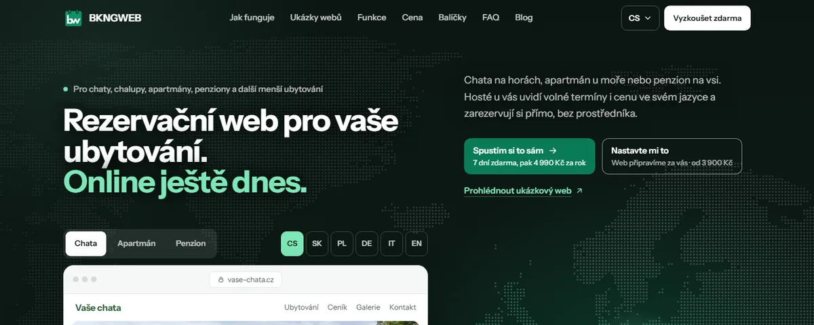
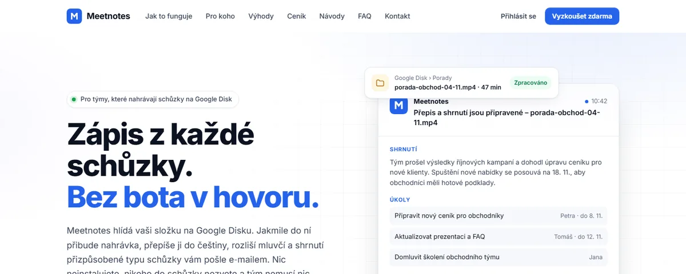
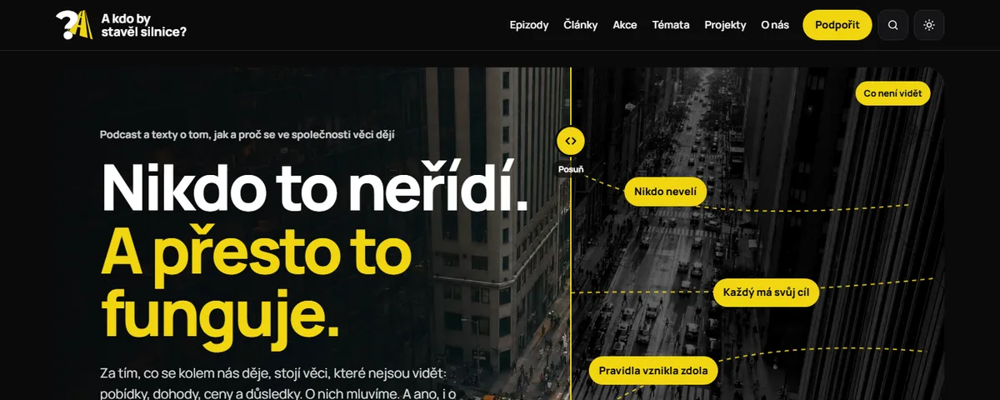

<!-- intro -->
**Hi, I'm Václav.** I help companies check digital projects before they sign, and I design and run my own web products.
Most of my work lives in private repositories; below is an overview of what it does, plus my open-source foobar2000 components.

---

# Václav Veselý

Dělám **technický dozor pro digitální projekty**: než firma podepíše nabídku na web, CRM, AI automatizaci
nebo interní systém, ověřím, jestli dává technicky, provozně a obchodně smysl.
Vedle toho navrhuji a provozuji vlastní digitální produkty. Většina z nich je v soukromých repozitářích,
proto tu najdete jejich popis, ne kód.

## Na čem pracuji

### BKNGWEB · rezervační weby pro menší ubytování

Hotový rezervační web pro chaty, chalupy, apartmány a penziony, spuštěný během jednoho dne.
- přímé rezervace bez provize zprostředkovatele, ceník a kalendář obsazenosti,
- 6 jazyků (CS, SK, PL, DE, IT, EN),
- synchronizace obsazenosti s Booking.com a Airbnb přes iCal,
- online platby a předplatné, jedna platforma pro mnoho samostatných webů (multi-tenant).

*Astro, Tailwind, PocketBase, Stripe, Netlify* · **[bkngweb.com](https://bkngweb.com)**

### Meetnotes · zápisy ze schůzek bez bota v hovoru

Služba hlídá složku na Google Disku. Jakmile do ní přibude nahrávka schůzky, přepíše ji do češtiny,
rozliší mluvčí a pošle e-mailem shrnutí s úkoly a rozhodnutími, přizpůsobené typu schůzky.
- nic se neinstaluje a do hovoru nikdo nepřibývá,
- fronta zpracování s administrací a zákaznická zóna s tarify.

*Node.js (Fastify), BullMQ, React, PocketBase, Whisper, Docker* · **[meetnotes.cz](https://meetnotes.cz)**

### BTC Privacy Auditor · co o vás prozrazuje bitcoinový blockchain

Vzdělávací web o soukromí v Bitcoinu s analýzou veřejné adresy.
- analýza běží přímo v prohlížeči, server adresu vůbec nevidí,
- vysvětluje, jak spolehlivé jsou jednotlivé závěry a co s nimi dělat,
- bez registrace, cookies a měření návštěvnosti; zprávy připravuje AI a schvaluje člověk.

*Next.js (statický export), TypeScript, Esplora API, přísná CSP* · **[btcpa.app](https://btcpa.app)**

### CRM pro iShowroom · obchodní pipeline
Systém, který z firemních databází dělá seznam obchodních příležitostí připravený pro CRM.
- příjem exportů a filtr relevance,
- obohacení dat o firmách, scoring a segmentace,
- výstupy připravené k importu do CRM a schvalovací workflow pro obchodníky.

*Python, datové pipeline* · interní nástroj, bez veřejné ukázky

## Podcast a provoz

### A kdo by stavěl silnice? · web podcastu

Web podcastu a článků o tom, jak a proč se ve společnosti věci dějí. Rychlý statický web bez reklam,
cookies a sledování. *Astro* · **[kdobystavelsilnice.cz](https://kdobystavelsilnice.cz)**

### Vlastní webový server
Sdílený server pro statické weby postavený celý z konfigurace v repozitáři: HTTPS, bezpečnostní
hlavičky, nasazení přes kontrolovanou bránu s ověřením integrity a automatické testy konfigurace.
Server je jednorázový, kdykoli se dá postavit znovu. *Caddy, cloud-init, GitHub Actions*

## Menší nástroje
- **Health Hub**: soukromá aplikace pro výživu, pohyb a váhu s AI vyhodnocením; data oddělená podle uživatele, přístupové údaje šifrované, instalovatelná do telefonu (PWA).
- **ShortsCreator**: z dlouhého videa automaticky vyrobí krátká vertikální videa s titulky (přepis řeči, střih, formát 9:16).
- **Politický kompas 2025**: interaktivní kalkulačka k volbám do Sněmovny, 28 otázek ve 4 osách a pozice 37 stran.
- **AI nástroje**: skilly pro práci s AI agenty, například sdílená paměť projektu napříč konverzacemi nebo strategické přemýšlení od mechanismů místo „best practices“.

## Open source
| Projekt | Popis |
|---|---|
| [foobar-grid-view](https://github.com/veselyvaclavcz/foobar-grid-view) | Mřížka obalů alb pro foobar2000 |
| [foobar-spectrum-seekbar](https://github.com/veselyvaclavcz/foobar-spectrum-seekbar) | Seekbar se spektrální vizualizací pro foobar2000 |
| [codex_skills](https://github.com/veselyvaclavcz/codex_skills) | Skilly pro AI agenta Codex: paměť projektu, úsporný workflow, UI design |
| [foo_artist_view](https://github.com/veselyvaclavcz/foo_artist_view) | Panel s biografií interpreta pro foobar2000 (archiv) |

## Kontakt
**[veselyvaclav.cz](https://veselyvaclav.cz)**
